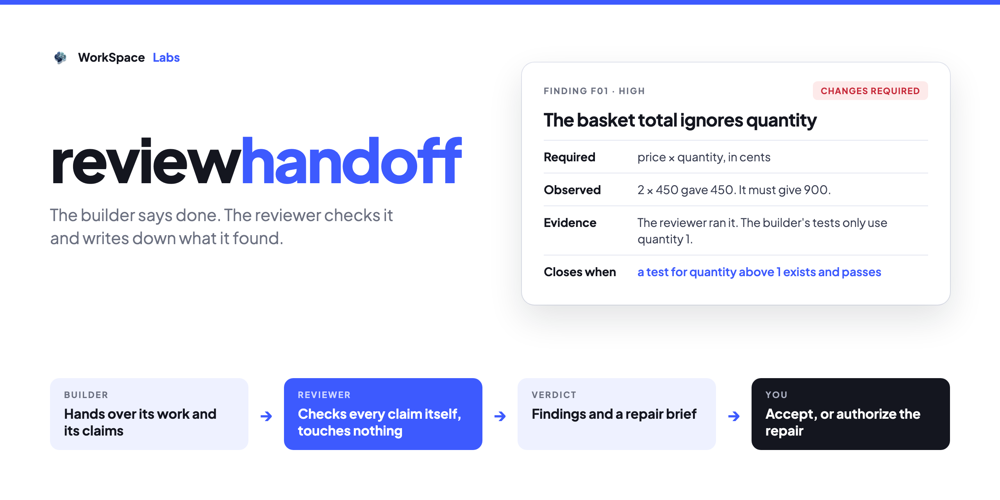

# An independent review handoff for AI agents



**A builder agent says "done" and hands over its work. If the reviewer only reads the builder's report and agrees, nothing was reviewed.**

This is the reviewer's side, packaged as an Agent Skill. The reviewing agent checks the work itself, keeps what it verified apart from what the builder only claimed, and writes each problem as a finding another engineer can reproduce. When something must be corrected, it ends with a repair brief the owner can authorize and pass back. Then it stops: the owner accepts, and the owner decides what happens next.

It is the partner of [a builder handoff for AI agents](https://github.com/workspace-labs/agent-builder-handoff). That one decides how finished work is handed over; this one decides how it is checked.

The skill is in this repo — [`skills/`](skills).

---

## What it asks of an agent

- **Know exactly what is being reviewed.** The commit, the uncommitted changes and the built artifact are identified first, and checked again before the verdict.
- **Treat the builder's report as claims.** Every important claim gets its own line: claim, criterion, evidence, result, and who ran the check.
- **Try to prove it wrong.** Follow each rule through every input route and lifecycle state, with expected values that do not come from the code under review.
- **Sort every issue.** Introduced by this change, already there but inside this task, a side regression, or unrelated debt. Only the first three can block.
- **Write the correction as an outcome.** What must become true and how to prove it. The builder chooses how.
- **Close nothing early.** A finding is closed only when everything it originally required is there, including its regression test.
- **Touch nothing.** The reviewer does not edit, format, commit or repair the work it reviews.

---

## Use it

One line, for every project on your machine:

```bash
npx skills add workspace-labs/agent-review-handoff -g
```

Or copy it by hand:

```bash
git clone https://github.com/workspace-labs/agent-review-handoff.git
mkdir -p ~/.codex/skills
cp -R agent-review-handoff/skills/independent-review-handoff ~/.codex/skills/
```

It is written for Codex as the reviewer, with Claude as the builder unless a project names another.

The core is [`SKILL.md`](skills/independent-review-handoff/SKILL.md), and four reference files load only when the review needs them. A project's own rules, its recorded decisions and the owner's instructions always come first.

---

## What it does not do

- It never starts an agent, sends a message or assigns the repair.
- It never authorizes a release or begins the next task.
- Its `ACCEPT` is a technical recommendation. Acceptance belongs to the owner.

---

## Status

Version 1.1.0. The package has offline checks (`python3 -m unittest discover tests`). The nine behaviour cases in [`tests/behavioral-cases.md`](tests/behavioral-cases.md) are written but not yet run; see [CHANGELOG.md](CHANGELOG.md).

---

<sub>by Workspace Labs · the patterns beside it: <a href="https://github.com/workspace-labs/agent-builder-handoff">a builder handoff for AI agents</a> and <a href="https://github.com/workspace-labs/agent-engineering-standard">an engineering standard for AI agents</a>.</sub>
